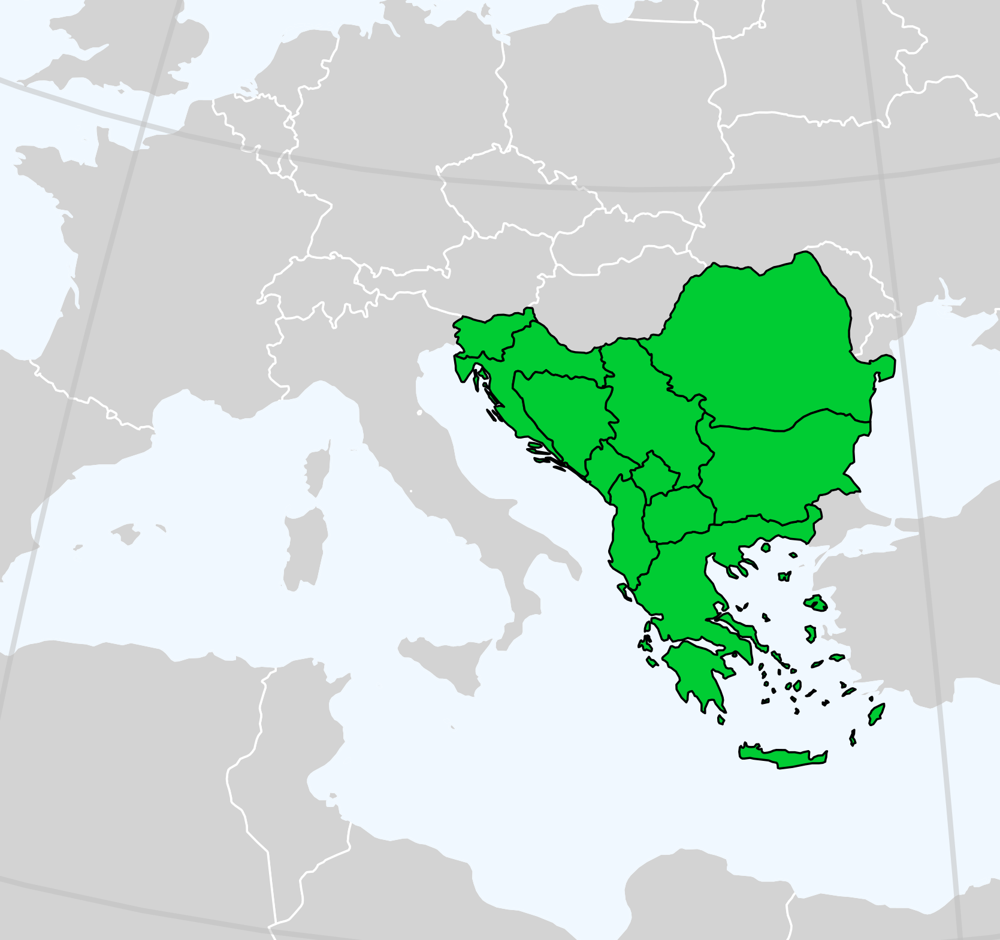

# Balkans {#sec-balkans .unnumbered}

There isn't a conclusive list for the countries that constitute the Balkans. For the purpose of our presentation let's assume that Balkans are comprised of Albania, Bulgaria, Bosnia and Herzegovina, Croatia, Greece, Montenegro, North Macedonia, Romania, Serbia and Slovenia.

{#fig-balkan_countries width="75%"}

```{r}
# Imports
library(readr)
library(dplyr)
library(echarts4r)
library(echarts4r.maps)
library(DT)

# Load UN population dataset
df <- read_csv("data/data.csv")
```

## Former Yugoslav Republics {#sec-former_yug_rep .unnumbered}

Bosnia, Croatia and Serbia were the largest constituents of Yugoslavia in terms of both population and area.

```{r}
bcs <- c("Bosnia and Herzegovina", "Croatia", "Serbia")

df_bcs <- df |> 
  filter(country %in% bcs)
```

```{r}
#| label: fig-bosnia_croatia_serbia
#| fig-cap: "Bosnia, Croatia and Serbia Population 1950 - 2026"
df_bcs |> 
  group_by(country) |> 
  e_charts(year) |> 
  e_tooltip(trigger = "axis", backgroundColor = "#FFFFFF") |>
  e_line(population, symbol = "none") |> 
  e_x_axis(name = "Year", min = 1950, max = 2026) |> 
  e_y_axis(name = "Population")|> 
  e_theme("azul")
```

Following the ethnic conflicts that occurred in 1991 and the breakup of Yugoslavia in 1992 all three countries displayed a decline, a trend that continues until today. Bosnia and Herzegovina experienced a dramatic drop in 1991 and then a surge in 1995, which marks the termination of the war and the gradual return of the refugees.

```{r}
msn <- c("Montenegro", "North Macedonia", "Slovenia")

df_msn <- df |> 
  filter(country %in% msn)
```

```{r}
#| label: fig-montenegro_north_macedonia_slovenia
#| fig-cap: "Montenegro, North Macedonia and Slovenia Population 1950 - 2026"
df_msn |> 
  group_by(country) |> 
  e_charts(year) |>
  e_tooltip(trigger = "axis", backgroundColor = "#FFFFFF") |>
  e_line(population, symbol = "none") |> 
  e_x_axis(name = "Year", min = 1950, max = 2026) |> 
  e_y_axis(name = "Population")|> 
  e_theme("azul")
```

On the other hand Montenegro, North Macedonia and Slovenia were relatively unaffected from the ethnic conflicts. Nevertheless the population growth rate of Montenegro and Slovenia was decreased. North Macedonia's population after positive growth rates which lasted from 1994 to 2005, displayed a steady decline ever since.

```{r}
#| label: tbl-north_macedonia_diff_table
#| tbl-cap: Population difference between two successive years (North Macedonia)
#| tbl-cap-location: bottom
df_msn |>
  filter(country == "North Macedonia", year >= 1993 & year <= 2026) |>
  mutate(diff = population - lag(population)) |>
  rename(Country = country, Year = year, Population = population,
         Difference = diff) |> 
  datatable(options = list(searching = FALSE))
```

## Albania, Bulgaria, Greece and Romania {#sec-bulgaria_greece_romania .unnumbered}

After the fall of communism in Albania, Bulgaria and Romania the population of these countries has seen a constant decline. In Albania and Bulgaria the power transition was pretty much bloodless, not so in Romania where the casualties during the [Romanian revolution](https://en.wikipedia.org/wiki/Romanian_revolution) of 1989 were between 689 and 1290 depending on the source.

```{r}
bgr <- c("Bulgaria", "Greece", "Romania")

albania <- c("Albania")

df_bgr <- df |> 
  filter(country %in% bgr)

df_alb <- df |> 
  filter(country %in% albania)
```

```{r}
#| label: fig-bulgaria_greece_romania
#| fig-cap: "Bulgaria, Greece and Romania Population 1950 - 2026"
df_bgr |> 
  group_by(country) |> 
  e_charts(year) |>
  e_tooltip(trigger = "axis", backgroundColor = "#FFFFFF") |>
  e_line(population, symbol = "none") |> 
  e_x_axis(name = "Year", min = 1950, max = 2026) |>
  e_y_axis(name = "Population")|> 
  e_theme("azul")
```

Greece was part of the part of the [Western Bloc](https://en.wikipedia.org/wiki/Western_Bloc) during the Cold War. After years of concesutive positive growth rates, the population of the country entered a downward trend which lasts from 2010 until today. The main reasons are immigration to developed countries following the 2009 - 2010 debt crisis and declining birth rates.

```{r}
#| label: fig-albania
#| fig-cap: "Albania Population 1950 - 2026"
df_alb |> 
  group_by(country) |> 
  e_charts(year) |>
  e_tooltip(trigger = "axis", backgroundColor = "#FFFFFF") |>
  e_line(population, symbol = "none") |> 
  e_x_axis(name = "Year", min = 1950, max = 2026) |> 
  e_y_axis(name = "Population")|> 
  e_theme("azul")
```

## Present Situation

This donut chart displays the 2026 population for the Balkan countries.

```{r}
balkans <- c(bcs, msn, bgr, albania)
country <- c()

df_balkans <- df |> 
  filter(country %in% balkans)
```

```{r}
#| label: fig-balkans_donut_2026
#| fig-cap: "Balkans 2026 population share by country"
df_balkans |>
  filter(year == 2026) |> 
  e_charts(country) |> 
  e_pie(population, radius = c("50%", "70%")) |> 
  e_tooltip(backgroundColor = "#FFFFFF") |> 
  e_theme("azul")
```

## Map

In the following interactive map, hover your mouse over a country to see its population. You can also use the slider below the map or click play to see how the population changes over time.

```{r}
#| label: fig-interactive_map
#| fig-cap: "Interactive population map"

# The map for the most part of it, was AI generated with Claude.

library(rnaturalearth)
library(sf)

balkans_list <- c(
  "Albania", "Bosnia and Herzegovina", "Bulgaria", "Croatia", "Greece",
  "Montenegro", "North Macedonia", "Romania", "Serbia", "Slovenia"
)

df_balkans <- df |> 
  filter(country %in% balkans_list)

df_balkans_map_data <- df_balkans |>
  mutate(
    country = case_when(
      country == "Bosnia and Herzegovina" ~ "Bosnia and Herz.",
      TRUE ~ country
    )
  )

balkan_countries <- c(
  "Albania", "Bosnia and Herz.", "Bulgaria", "Croatia", "Greece", "Kosovo",
  "Montenegro", "North Macedonia", "Romania", "Serbia", "Slovenia"
)

# Country polygons
world <- ne_countries(scale = "medium", returnclass = "sf")

balkans <- world |>
  filter(name %in% balkan_countries) |>
  select(name)

# Convert to GeoJSON text (echarts expects feature properties$name)
geojson_file <- tempfile(fileext = ".geojson")
st_write(balkans["name"], geojson_file, driver = "GeoJSON", quiet = TRUE)
balkans_json <- paste(readLines(geojson_file, warn = FALSE), collapse = "")

# Data to colour the map by (population, in millions)
map_data <- df_balkans_map_data |> 
  mutate(population_m = round(population / 1e6, 3)) |> 
  rename(name = country)


years <- unique(map_data$year) |> sort()

titles <- lapply(years, function(y) {
  list(
    text    = paste0("UN Estimates ", y),
    left    = "center"
  )
})

# Build map
map_data |>
  group_by(year) |>
  e_charts(name, timeline = TRUE) |>
  e_map_register("Balkans", balkans_json) |>
  e_map(
    population_m, map = "Balkans", roam = TRUE,
    itemStyle = list(borderColor = "#ffffff", borderWidth = 1)
  ) |>
  e_visual_map(
    population_m
  ) |>
  e_timeline_serie(title = titles) |>
  e_tooltip(formatter = htmlwidgets::JS("
    function(p) {
      return '<strong>' + p.name + '</strong><br/>' +
             (isNaN(p.value) ? 'n/a' : p.value + ' M people');
    }
  "))
```
