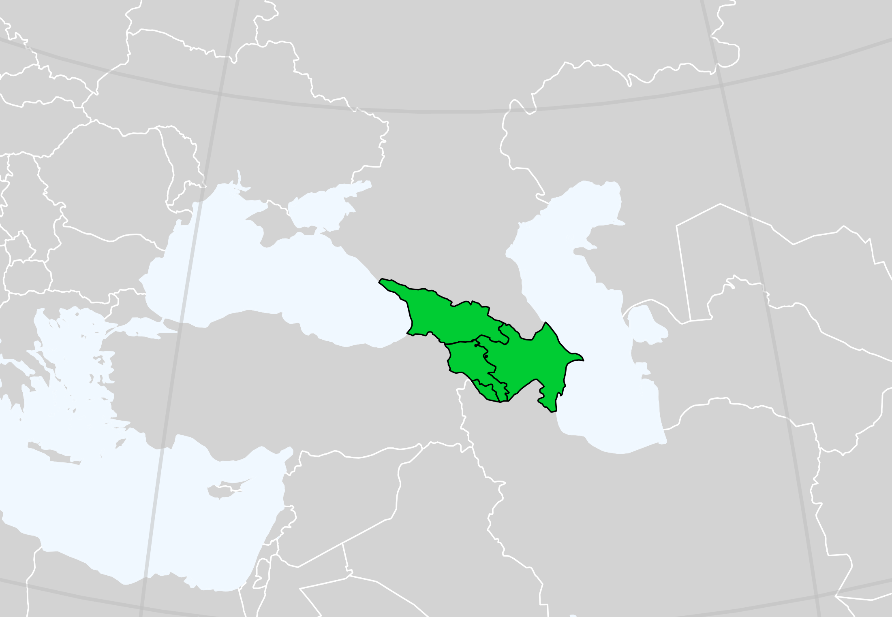

# Caucasus {#sec-caucasus .unnumbered}

Caucasus is situated between the Black Sea and the Caspian Sea. The broader Caucasus encompasses south regions of Russia, but in this chapter we will focus solely on Azerbaijan, Armenia and Georgia.

{#fig-caucasus width="80%"}

All three countries are former Soviet republics which gained their independence in 1991.

```{r}
# Imports
library(readr)
library(dplyr)
library(echarts4r)

# Load UN population dataset
df <- read_csv("data/data.csv")
```

```{r}
caucasus <- c("Armenia", "Azerbaijan", "Georgia")

df_caucasus <- df |> 
  filter(country %in% caucasus)
```

```{r}
#| label: fig-azerbaijan_armenia_georgia
#| fig-cap: "Azerbaijan, Armenia and Georgia Population 1950 - 2026"
df_caucasus |> 
  group_by(country) |> 
  e_charts(year) |> 
  e_tooltip(trigger = "axis", backgroundColor = "#FFFFFF") |>
  e_line(population, symbol = "none") |> 
  e_x_axis(name = "Year", min = 1950, max = 2026) |> 
  e_y_axis(name = "Population")|>
  e_theme("azul")
```

Both Armenia and Georgia had their population significantly decreased in the years following their independence. Azerbaijan belongs to those former Soviet republics where the population continued to increase albeit in a slower pace. The majority of Central Asian former Soviet republics displayed a similar pattern as well.

```{r}
aze_growth_rate <- df_caucasus |> 
  filter(country == "Azerbaijan") |> 
  mutate(
    growth_rate = ((population - lag(population)) / lag(population) * 100) |>
      round(3)
  )
```

```{r}
#| label: fig-azerbaijan_growth_rate
#| fig-cap: "Population growth rate of Azerbaijan 1951 - 2026"
aze_growth_rate |>  
  e_charts(year) |> 
  e_tooltip(trigger = "axis", backgroundColor = "#FFFFFF") |>
  e_line(growth_rate, symbol = "none", name = "Growth Rate") |> 
  e_x_axis(name = "Year", min = 1951, max = 2026) |>
  e_y_axis(name = "Growth Rate") |>
  e_color("#F5A503")
```

By paying close attention to Armenia's population in isolation —the larger scale of Georgia's and Azerbaijan's populations in @fig-azerbaijan_armenia_georgia make smaller trends harder to discern— we can detect a surge around 2024 which is attributable to the [expulsion of Nagorno-Karabakh Armenians](https://en.wikipedia.org/wiki/Expulsion_of_Nagorno-Karabakh_Armenians) in the aftermath of Azerbaijan's offensive in Nagorno-Karabakh in September of 2023.

```{r}
#| label: fig-armenia_surge_2024
#| fig-cap: "Surge in Armenian's Population around 2024"
df_caucasus |> 
  filter(country == "Armenia") |> 
  e_charts(year) |> 
  e_tooltip(trigger = "axis", backgroundColor = "#FFFFFF") |>
  e_line(population, symbol = "none", name = "Population") |> 
  e_x_axis(name = "Year", min = 1980, max = 2026) |> 
  e_y_axis(name = "Population", min = 2600000)|>
  e_theme("azul") |> 
  e_annotations(
    annotations = list(
      list(
        id = 0,
        x = 2023,
        y = 2943000,
        text = "Azerbaijan's military offensive",
        offsetX = -55,
        offsetY = -200,
        rectStyle = list(
          shape = list(width = 180)
        )
      ),
      list(
        id = 0,
        x = 2020,
        y = 2890000,
        text = "Second Nagorno-Karabakh War",
        offsetX = -20,
        offsetY = -100,
        rectStyle = list(
          shape = list(width = 180)
        )
      )
    )
  )
```
